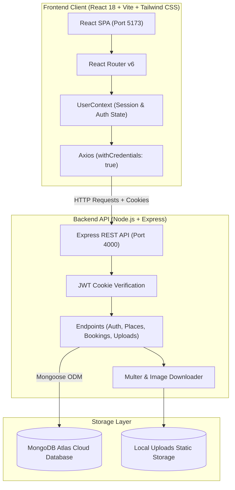
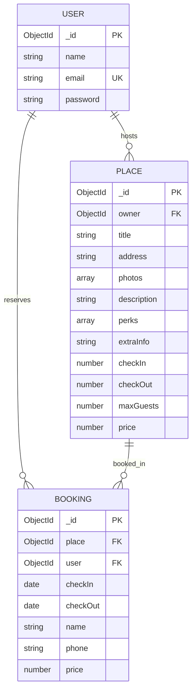

# 🏨 HotelBazaar — Full-Stack MERN Vacation Rental & Booking Platform

A production-ready, full-stack **MERN (MongoDB, Express.js, React 18, Node.js)** accommodation booking and vacation rental web application inspired by Airbnb. Built with client-side routing, authenticated host listings, image uploading (via links or local files), date calculation engines, and reservation management.

---

## 🌟 Key Features

### 👤 Guest Experience
- **Explore Accommodations**: Responsive catalog grid showcasing vacation rentals with pricing, primary photos, and geographic locations.
- **Detailed Place Pages**: High-resolution image galleries, host profiles, full descriptions, check-in/out schedules, guest limits, and perks.
- **Dynamic Reservation Widget**: Real-time calendar date picker calculating night totals and stay pricing via `date-fns`.
- **Personal Bookings Portal**: Review confirmed reservations with dates, total costs, and direct accommodation reference links.

### 🏡 Host Capabilities
- **Create & Manage Listings**: Create new rental properties with titles, addresses, descriptions, extra guidelines, price per night, and custom perks (WiFi, Free Parking, TV, Private Entrance, Pets Allowed).
- **Multi-Photo Upload Pipeline**:
  - Direct image scraping via web link (`image-downloader`).
  - Local multi-file device uploads (`multer`).
  - Reorder, delete, and designate primary thumbnail photos.
- **Listing Modifications**: Real-time updates to listing details, guest capacity, and nightly rates.

### 🛡️ Authentication & Security
- **JWT Cookie Sessions**: Secure token signing stored in HTTP-Only browser cookies.
- **Bcrypt Password Hashing**: Adaptive salt rounds protecting user credentials.
- **Owner-Protected Mutations**: Verification middleware preventing unauthorized edits or deletions of other hosts' properties.

---

## 🏗️ System Architecture



---

## 🗄️ Database Schema Design



---

## 🔌 RESTful API Endpoints

| Method | Endpoint | Description | Access |
|---|---|---|---|
| `POST` | `/api/register` | Register new user account | Public |
| `POST` | `/api/login` | Authenticate user & issue JWT cookie | Public |
| `GET` | `/api/profile` | Fetch authenticated user profile | Authenticated |
| `POST` | `/api/logout` | Clear session cookie | Public |
| `GET` | `/api/places` | Retrieve all public place listings | Public |
| `GET` | `/api/places/:id` | Retrieve single place details | Public |
| `POST` | `/api/places` | Create new rental listing | Authenticated |
| `PUT` | `/api/places` | Update owned rental listing | Authenticated (Owner) |
| `GET` | `/api/user-places` | Retrieve places created by current user | Authenticated |
| `POST` | `/api/upload-by-link` | Fetch and store image from URL | Authenticated |
| `POST` | `/api/upload` | Upload photos from device | Authenticated |
| `POST` | `/api/bookings` | Book a place reservation | Authenticated |
| `GET` | `/api/bookings` | Retrieve user's confirmed reservations | Authenticated |

---

## 🚀 Quick Start Guide

### Prerequisites
- [Node.js](https://nodejs.org/) (v18 or higher recommended)
- [MongoDB Atlas](https://www.mongodb.com/cloud/atlas) or local MongoDB instance

### 1-Click Launch (Windows)
Double-click **`START_BOOKING_APP.bat`** in the project root. It will automatically:
1. Boot the Backend API on `http://localhost:4000`
2. Boot the React Frontend on `http://localhost:5173`

---

### Manual Setup

#### 1. Configure Environment
In `api/.env`:
```env
PORT=4000
MONGO_URL=mongodb+srv://<username>:<password>@cluster0.mongodb.net/booking-app?retryWrites=true&w=majority
JWT_SECRET=your_jwt_secret_key_here
CLIENT_URL=http://localhost:5173
```

In `client/.env`:
```env
VITE_API_BASE_URL=http://localhost:4000/api
```

#### 2. Seed Database (Optional)
Populate your database with sample luxury vacation rentals (Malibu villa, Aspen chalet, Manhattan loft, etc.):
```bash
cd api
npm run seed
```
> **Default Test Account:**
> - Email: `host@example.com`
> - Password: `password123`

#### 3. Start Application
```bash
# Terminal 1: Backend API
cd api
npm install
npm run dev

# Terminal 2: React Frontend
cd client
npm install
npm run dev
```

Visit **`http://localhost:5173`** in your browser.

---

## 📄 License
This project is open-source and available under the [MIT License](LICENSE).
